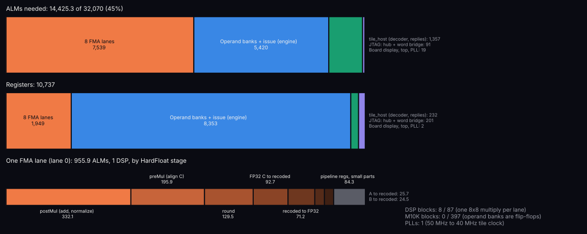
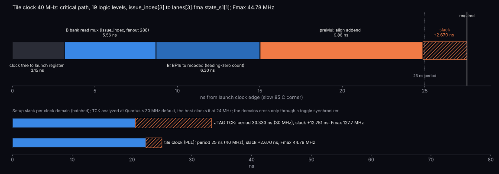
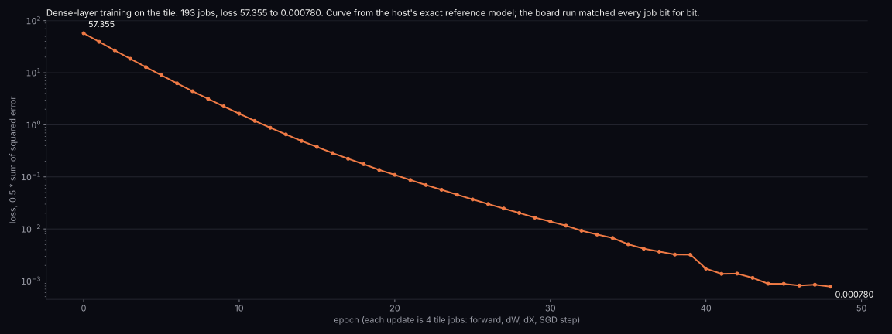

# Results

Measured on a DE1-SoC (5CSEMA5F31C6), 2026-10-30, from this repository's `make build program`.

| Metric | Result |
|---|---|
| Fit | 14,425 / 32,070 ALMs (45%), 8 DSPs, 1 PLL |
| Tile clock | 40 MHz; Fmax 44.8 MHz, setup slack +2.67 ns |
| Job | 67 clocks, as specified |
| Peak rate | 611 MFLOPS on the chip, one job at a time |
| End-to-end rate | About 0.4 MFLOPS: JTAG and Python are the bottleneck |
| Training | 193 jobs, loss 57.355 → 0.000780 |
| Random jobs | 500 jobs, 256,000 FMAs bit-identical |

The operand and accumulator banks are flip-flops (8,353 engine registers, no M10K), and each lane uses one DSP block.

The critical path runs from the engine's issue counter through the B-bank read mux and lane 3's BF16 conversion into the addend alignment: 19 logic levels, 59% of the data delay in routing. Quartus analyzes TCK at its 30 MHz default; the host clocks it at 24 MHz.

The curve comes from the host's reference model; the board returned the same bits for every one of the 193 jobs. Figures: `scripts/figures.py`.

The training result matches chip-lab simulation (57.3555 → 0.000779807). Random operands include subnormals and wide exponents. The reference agreed with C `fmaf` on 200,000 cases.

## Not covered

- Infinities and NaNs: the host reference covers finite values. The chip lab's suite covers specials in simulation.
- Overlapped transfers: the host runs one job at a time, so the two-buffer overlap is unused.
- Sustained throughput: the 611 MFLOPS figure assumes operands are already loaded. The chip lab's 585 MFLOPS streamed figure counts transfers through an ideal 32-bit port, which JTAG is not.
